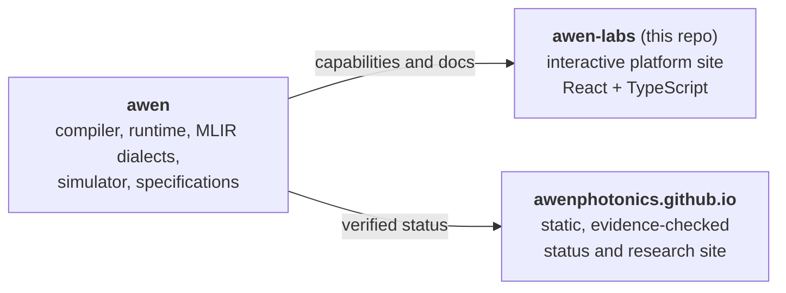

<div align="center">

# AWEN Labs

**The web front end for AWEN, an open, experimental software stack for computing with light.**

[](LICENSE)

</div>

AWEN Labs is the public-facing web experience for the AWEN photonic computing
platform. It presents the platform stack, documentation entry points, research
areas, downloads, and community channels in a single responsive site built with
Vite, React, TypeScript, Tailwind CSS, and shadcn/ui components.

## Where this fits

AWEN is organized as three repositories:



| Repository | Role |
|---|---|
| [awen](https://github.com/marcpoliquin5/awen) | The technology: an experimental heterogeneous compiler and runtime for programmable photonic linear algebra (Rust, MLIR, Python) |
| **awen-labs** | This repository: the interactive platform site (pages for Platform, Research, Docs, Downloads, Community, About) |
| [awenphotonics.github.io](https://github.com/marcpoliquin5/awenphotonics.github.io) | A static status site whose public copy is limited to repository-verifiable statements ([live site](https://marcpoliquin5.github.io/awenphotonics.github.io/)) |

> **Content status.** Some page copy in this site (for example research
> summaries, benchmark figures, and download descriptions) is presentational and
> has not been reconciled with AWEN's evidence policy. The authoritative statement
> of what AWEN implements today is the core repository's
> [implementation status](https://github.com/marcpoliquin5/awen/blob/main/docs/IMPLEMENTATION-STATUS.md).

## Project structure

```text
src/
├── pages/         Route-level pages (Index, Platform, Research, Docs, Downloads, Community, About)
├── components/    Shared layout and UI components (shadcn/ui based)
├── hooks/         React hooks
├── integrations/  Supabase client and generated types
└── lib/           Utilities
supabase/          Versioned migrations and project configuration
scripts/           Repository security-policy check
```

## Local setup

Install a supported Node.js release and copy the value-free configuration
contract:

```powershell
Copy-Item .env.example .env.local
npm ci
npm run check:security
npm run lint
npm run dev
```

Populate `.env.local` with:

- `VITE_SUPABASE_PROJECT_ID`: `rzgqmmjvjmsfyetgzjvi`;
- `VITE_SUPABASE_URL`: `https://rzgqmmjvjmsfyetgzjvi.supabase.co`; and
- `VITE_SUPABASE_PUBLISHABLE_KEY`: an active modern `sb_publishable_` key from
  that project.

Every `VITE_` value is embedded in the browser bundle. Never place a service-role
key, database password, JWT signing secret, management access token, or other
privileged value in any `VITE_` variable, local file intended for commit, GitHub
variable, build log, or artifact.

The production build uses the same variables:

```powershell
npm run build
```

## Supabase security boundary

The browser key identifies a project; it does not authorize trusted operations.
Database authorization must be enforced with Row Level Security and explicit
anonymous/authenticated policies. Key reissue and RLS review are independent
operations.

The generated database types currently expose no public tables, views, or
functions, and the application makes no database, authentication, storage, or RPC
calls. If a public table is added, the repository security check requires
versioned migrations that enable RLS and create explicit policies before CI can
pass. Policy tests should exercise anonymous and authenticated roles before the
new data access is deployed.

The connected hosted project currently contains no public tables, views,
functions, storage buckets, Edge Functions, or development branches. The
versioned `20260814030824_secure_rls_event_trigger.sql` migration preserves the
automatic RLS event trigger while moving its `SECURITY DEFINER` function out of
the exposed API schema and revoking execution from `PUBLIC`, `anon`,
`authenticated`, and `service_role`. Supabase's security and performance
advisors report no remaining findings.

The initial repository import contained one legacy Supabase anon JWT in `.env`.
It was classified as the `anon` role, not a service-role credential. The current
tree no longer contains the value. Its exact historical Gitleaks fingerprint is
documented in `.gitleaksignore` so the known browser-safe finding does not mask
any new JWT or privileged-secret finding.

That historical key belonged to project `nbwkthmgoubsflezymua`. The connected
account has no permission to that project and its API hostname no longer
resolves, so the old key and endpoint are decommissioned. The replacement
project is `rzgqmmjvjmsfyetgzjvi`; this application rejects legacy JWT API keys
and accepts only its independently managed modern publishable key.

## Automated checks

Pull requests and `main` run a complete-history Gitleaks scan, repository security
policy, ESLint, and a production build using non-secret CI fixtures. GitHub secret
scanning and push protection are also enabled at repository level.
